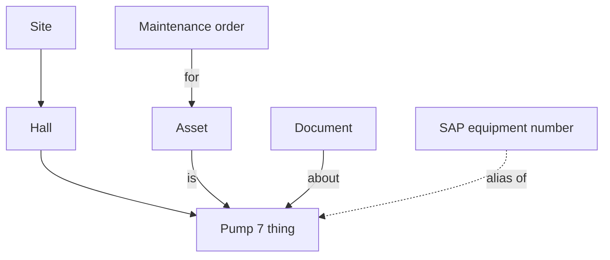

Der Knowledge Graph ist eine Menge von Datensätzen und den Verknüpfungen zwischen ihnen. Ein Datensatz kann ein Thing (ein Gerät), ein Ort (Standort, Werk, Halle, Linie), eine Anlage, ein Wartungsauftrag oder ein Dokument sein. Eine Verknüpfung sagt, wie zwei Datensätze zusammenhängen: Diese Maschine steht in jener Halle, dieser Auftrag gilt für jene Anlage, dieses Handbuch behandelt jenes Gerät. **Erkunden** zeichnet den Graphen, und Ask Nimble folgt seinen Verknüpfungen, um Fragen zu beantworten.

## Die Bestandteile {#the-parts}

| Bestandteil | Was es ist |
| --- | --- |
| **Datensatz** | Ein Element im Graphen, etwa eine Halle oder ein Auftrag. Jeder Datensatz hat einen **Typ**. |
| **Typ** | Eine Art von Datensatz: seine Felder und die Beziehungen, die er haben darf. Systemtypen werden mit der Plattform ausgeliefert; eigene fügen Sie hinzu. |
| **Trait** | Ein Bündel von Feldern, das sich Typen teilen, etwa eine Position in der Hierarchie oder eine Zugriffsliste. Siehe [Typen und Traits](./types-and-traits.mdx). |
| **Ebene** | Ein Platz im Enthaltenseinsbaum. Standorte enthalten Hallen, Hallen enthalten Linien. Things werden auf einer Ebene platziert. |
| **Beziehung** | Eine benannte Verknüpfung von einem Datensatz zu einem anderen, etwa `feedsInto`. |
| **Alias** | Eine Kennung, die ein Datensatz in einem anderen System hat. Eingehende Daten finden den Datensatz damit. |

Things stammen aus Ihren Geräten und werden synchron gehalten. Alles andere bringen Sie selbst ein: Ebenen von Hand in **Erkunden** aufbauen, Datensätze über [Konnektoren](./outside-source.mdx) aus anderen Systemen laden oder Dokumente zu einer Ebene hinzufügen.

:::info Ein Knowledge-Typ ist kein Thing-Typ
Ein **Thing-Typ** unter **Geräte** beschreibt das Interface eines Geräts. Ein Knowledge-**Typ** beschreibt jeden Datensatz im Graphen, auch ein Gerät, wie der Graph es sieht.
:::

## Wie sie zusammenspielen {#how-they-work-together}

Datensätze gelangen auf drei Wegen in den Graphen. Geräte erscheinen als Things, und ihre Live-Messwerte bleiben in Ihren Zeitreihendaten. Externe Systeme kommen über einen Konnektor oder Upload in eine Staging-Quelle, und ein **Mapping** macht aus jeder Zeile einen Datensatz eines Ihrer Typen. Menschen ergänzen Ebenen, Beziehungen und Dokumente in **Erkunden**.

Ein Datensatz, der per Alias zu einem vorhandenen passt, aktualisiert ihn, statt ihn zu duplizieren. Eine Zeile, die zu nichts passt, wartet unter **Verknüpfungen prüfen**, bis jemand das Gerät bestätigt, das sie beschreibt.

Der Zugriff folgt dem Datensatz. Datensätze mit dem Trait **Governed** listen die Gruppen und Benutzer auf, die sie lesen dürfen, und **Erkunden** und Ask Nimble zeigen nur, was die angemeldete Person öffnen darf.

## Die Wahl {#choosing-between-them}

| Sie möchten … | Nutzen Sie |
| --- | --- |
| Sehen, wo Things stehen und was in einer Halle nicht stimmt | **Erkunden** in der Ansicht **Hierarchie** |
| Jeden Datensatz eines Typs auflisten | **Erkunden** in der Ansicht **Tabelle** |
| Sehen, womit ein Datensatz verbunden ist | **Erkunden** in der Ansicht **Graph** |
| In Worten fragen, auch zu Dokumenten und Trends | [Ask Nimble](./ask.mdx) |
| Eine Messung über die Zeit darstellen | Ein [Dashboard](../visualize/dashboards.mdx) |

## Grenzen {#limits}

- Antworten sind nur so gut wie die Verknüpfungen. Ein Datensatz ohne Standort oder Beziehungen lässt sich bei einer Frage nach seinem Ort schwer finden. Die [Datenqualität](./data-health.mdx) listet diese Lücken auf.
- Ein Datensatz liegt auf einer Ebene. Wird ein Thing woanders platziert, wird es verschoben.
- Einen Typ einzuengen löscht keine Daten: Die Werte bleiben an vorhandenen Datensätzen und fallen nur aus dem Typ heraus.

## Siehe auch {#related}

- [Standorte und Gebäude abbilden](./map-sites.mdx)
- [Wie Ask Nimble antwortet](./ask-nimble-answers.mdx)
- [Typen und Traits](./types-and-traits.mdx)
