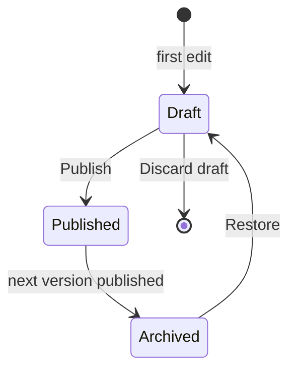

Thing types and interfaces both keep their schema in numbered versions. Your edits to measures and properties go into a draft that nothing uses. When you publish the draft it becomes the live version, and the version it replaces is archived.

## The parts

| Part | What it is |
| --- | --- |
| **Published** | The version in use. Things use the published version of their thing type. Thing types use the version of an interface they pinned. It can't be edited. |
| **Draft** | The next version, being edited. There is at most one draft. Its number is the number it gets when published. |
| **Archived** | A version that was replaced. You can compare it with another version or restore it. |
| **Changelog** | The note you enter when you publish, shown in the version history. |

A new thing type starts with an empty published v1. Your first edit opens draft v2.

## What goes into the draft

The rule is the same for thing types and interfaces: **every change to a measure or property goes into the draft, whatever field you change.** That includes names, types, units, ranges, descriptions, display names and, on interfaces, aliases. Adding and deleting fields goes into the draft too.

| You change | Where it is saved |
| --- | --- |
| A measure or property, on a thing type or an interface | The draft. Live after you publish. |
| The thing type's or interface's own settings: display name, description, tags (**Edit**) | Immediately. Not versioned. |
| **Mark as stable** on an interface | Immediately. Can't be undone. |
| **Show on overview** on a measure of a thing type | Immediately. A display preference, not part of the schema. |
| **Attach interface**, **Detach**, **Update to v2** on a thing type | Immediately. Not through the draft. |

{/* TODO(product): The interface Schema tab says "Descriptions and aliases save in place", and the API has an in-place update for them (PATCH /interfaces/{id} with a capabilities list). IoT Breeze never calls it: editing a description or alias of an interface field saves the whole draft instead. Which is intended? If in place is intended, this page and the thing type rule change. */}

Aliases exist only on interface fields. A thing type's measure and property forms don't have them. A field inherited from an interface can't be edited on the thing type; you edit it in the interface.

## How they work together

While a draft is open, the header shows **Draft v2 · 3 changes** and changed rows are marked **Draft: new** or **Draft: changed**. **Compare with v1** shows exactly what differs. **Publish v2** asks for a **Changelog**, tells you how many things (and, for an interface, thing types) the version affects, and archives v1. Devices use v2 from then on.

**Discard draft** deletes the draft and leaves the published version as it was. **Restore** on an archived version copies it into a new draft and takes you to the schema to review it. On an interface, restoring replaces a draft that is already open. Nothing goes live until you publish.

An interface adds one step. A thing type keeps using the interface version it pinned. When you publish v2 of the interface, thing types that attached v1 show **v2 available** and keep working with v1 until someone on that thing type selects **Update to v2**. **Compare** shows the difference first.

## Auto schema evolution does not use the draft

With **Auto Schema Evolution** on, a field that a device sends and the schema doesn't know is added to the thing type's published schema. This creates a new published version straight away and marks the field **auto-created**. If you have a draft open, the new field is added to it too, and your own edits stay. With it off, unknown fields are dropped.

## Limits

- A published version is immutable. To go back, restore the old version as a draft and publish it.
- A measure that exists only in a draft is unknown to the platform. Publish before devices send it.
- A thing type's **Name** and a field's **Name** can't change in any version.

## Related

- [Create a thing type](./create-thing-type.mdx) · [Reuse an interface across thing types](./reuse-interface.mdx)
- [Measure and property types](./measure-types.mdx)
