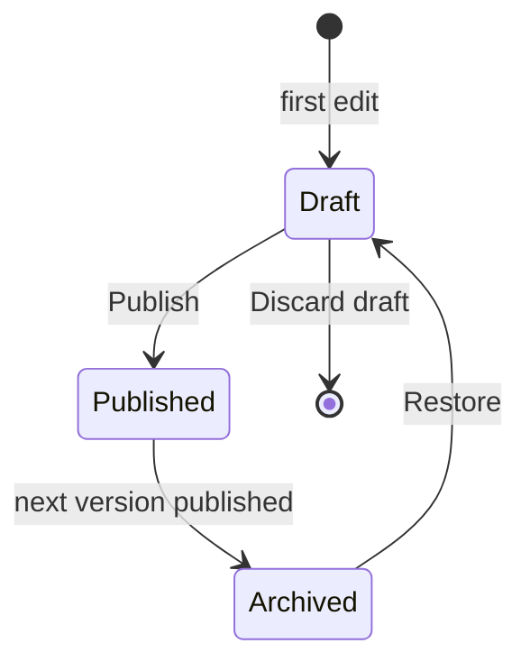

Thing-Typen und Interfaces halten ihr Schema in nummerierten Versionen. Ihre Änderungen an Messwerten und Eigenschaften landen in einem Entwurf, den nichts verwendet. Veröffentlichen Sie den Entwurf, wird er zur Live-Version, und die Version, die er ersetzt, wird archiviert.

## Die Bestandteile {#the-parts}

| Bestandteil | Was es ist |
| --- | --- |
| **Veröffentlicht** | Die Version in Verwendung. Things nutzen die veröffentlichte Version ihres Thing-Typs. Thing-Typen nutzen die Version eines Interfaces, die sie fixiert haben. Sie lässt sich nicht bearbeiten. |
| **Entwurf** | Die nächste Version, in Bearbeitung. Es gibt höchstens einen Entwurf. Seine Nummer ist die Nummer, die er beim Veröffentlichen erhält. |
| **Archiviert** | Eine Version, die ersetzt wurde. Sie können sie mit einer anderen Version vergleichen oder wiederherstellen. |
| **Änderungsnotiz** | Die Notiz, die Sie beim Veröffentlichen eingeben, angezeigt im Versionsverlauf. Bei Interfaces heißt sie **Änderungsprotokoll**. |

Ein neuer Thing-Typ beginnt mit einer leeren veröffentlichten v1. Ihre erste Änderung öffnet den Entwurf v2.

## Was in den Entwurf kommt {#what-goes-into-the-draft}

Die Regel ist für Thing-Typen und Interfaces dieselbe: **Jede Änderung an einem Messwert oder einer Eigenschaft kommt in den Entwurf, egal welches Feld Sie ändern.** Das umfasst Namen, Typen, Einheiten, Bereiche, Beschreibungen, Anzeigenamen und bei Interfaces Aliase. Auch das Hinzufügen und Löschen von Feldern kommt in den Entwurf.

| Sie ändern | Wo es gespeichert wird |
| --- | --- |
| Einen Messwert oder eine Eigenschaft an einem Thing-Typ oder Interface | Im Entwurf. Live nach dem Veröffentlichen. |
| Die eigenen Einstellungen des Thing-Typs oder Interfaces: Anzeigename, Beschreibung, Tags (**Bearbeiten**) | Sofort. Nicht versioniert. |
| **Als stabil markieren** an einem Interface | Sofort. Lässt sich nicht rückgängig machen. |
| **In der Übersicht anzeigen** an einem Messwert eines Thing-Typs | Sofort. Eine Anzeigeeinstellung, nicht Teil des Schemas. |
| **Interface anhängen**, **Entfernen**, **Auf v2 aktualisieren** an einem Thing-Typ | Sofort. Nicht über den Entwurf. |

{/* TODO(product): The interface Schema tab says "Descriptions and aliases save in place", and the API has an in-place update for them (PATCH /interfaces/{id} with a capabilities list). IoT Breeze never calls it: editing a description or alias of an interface field saves the whole draft instead. Which is intended? If in place is intended, this page and the thing type rule change. */}

Aliase gibt es nur an Interface-Feldern. Die Formulare für Messwerte und Eigenschaften eines Thing-Typs haben sie nicht. Ein von einem Interface geerbtes Feld lässt sich am Thing-Typ nicht bearbeiten; Sie bearbeiten es im Interface.

## Wie sie zusammenspielen {#how-they-work-together}

Solange ein Entwurf offen ist, zeigt der Kopfbereich **Entwurf v2 · 3 Änderungen**, und geänderte Zeilen sind mit **Entwurf: neu** oder **Entwurf: geändert** markiert. **Mit v1 vergleichen** zeigt genau, was abweicht. **v2 veröffentlichen** fragt nach einer **Änderungsnotiz**, nennt, wie viele Things (und bei einem Interface Thing-Typen) die Version betrifft, und archiviert v1. Geräte nutzen danach v2.

**Entwurf verwerfen** löscht den Entwurf und lässt die veröffentlichte Version, wie sie war. **Wiederherstellen** an einer archivierten Version kopiert sie in einen neuen Entwurf und führt Sie zur Prüfung zum Schema. Bei einem Interface ersetzt das Wiederherstellen einen bereits offenen Entwurf. Nichts geht live, bevor Sie veröffentlichen.

Ein Interface fügt einen Schritt hinzu. Ein Thing-Typ nutzt weiter die Interface-Version, die er fixiert hat. Veröffentlichen Sie v2 des Interfaces, zeigen Thing-Typen, die v1 angehängt haben, **v2 verfügbar** und arbeiten mit v1 weiter, bis jemand an diesem Thing-Typ **Auf v2 aktualisieren** wählt. **Vergleichen** zeigt vorher den Unterschied.

## Auto-Schema-Evolution nutzt den Entwurf nicht {#auto-schema-evolution-does-not-use-the-draft}

Ist **Auto-Schemas Entwicklung** an, wird ein Feld, das ein Gerät sendet und das Schema nicht kennt, zum veröffentlichten Schema des Thing-Typs hinzugefügt. Das erzeugt sofort eine neue veröffentlichte Version und markiert das Feld als **Automatisch erstellt**. Ist ein Entwurf offen, wird das neue Feld auch dort hinzugefügt, und Ihre eigenen Änderungen bleiben. Ist sie aus, werden unbekannte Felder verworfen.

## Grenzen {#limits}

- Eine veröffentlichte Version ist unveränderlich. Um zurückzugehen, stellen Sie die alte Version als Entwurf wieder her und veröffentlichen Sie sie.
- Ein Messwert, der nur in einem Entwurf existiert, ist der Plattform unbekannt. Veröffentlichen Sie, bevor Geräte ihn senden.
- Der **Name** eines Thing-Typs und der **Name** eines Felds können sich in keiner Version ändern.

## Siehe auch {#related}

- [Einen Thing-Typ anlegen](./create-thing-type.mdx) · [Ein Interface für mehrere Thing-Typen wiederverwenden](./reuse-interface.mdx)
- [Messwert- und Eigenschaftstypen](./measure-types.mdx)
