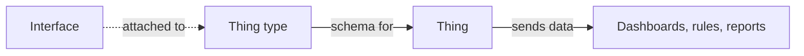

Wie beschreibe ich meine Geräte, damit IoT Breeze weiß, was sie senden? Legen Sie pro Art von Gerät einen Thing-Typ an, registrieren Sie jedes echte Gerät als Thing und teilen Sie Felder zwischen Thing-Typen über Interfaces. Alle drei finden Sie unter **Einstellungen › Onboarding**.

## Verstehen {#understand}
- [Thing-Typen, Things und Interfaces](./things-and-types.mdx): was jedes Objekt ist und wann Sie ein Interface brauchen.
- [Entwürfe, Veröffentlichen und Versionen](./drafts-and-versions.mdx): warum Ihre Schema-Änderungen die Geräte erst nach dem Veröffentlichen erreichen.

## Umsetzen {#do}
- [Einen Thing-Typ anlegen](./create-thing-type.mdx): die Messwerte und Eigenschaften einer Art von Gerät festlegen.
- [Ein Thing registrieren](./register-thing.mdx): ein echtes Gerät oder eine Anlage hinzufügen.
- [Ein Interface für mehrere Thing-Typen wiederverwenden](./reuse-interface.mdx): Felder teilen, abweichende Namen zuordnen, Smart-Dashboards erhalten.
- [Eingehende Daten bereinigen](./clean-up-data.mdx): Nachrichten vor dem Speichern umrechnen, prüfen oder anreichern.
- [Einen berechneten Messwert hinzufügen](./calculated-measures.mdx): einen Messwert beim Lesen mit einer Formel aus anderen Messwerten berechnen.
- [Things zu einem Aggregat-Thing zusammenfassen](./aggregate-things.mdx): die Messwerte von Mitglieds-Things summieren oder mitteln, etwa aller Wechselrichter einer Anlage.

## Nachschlagen {#look-up}
- [Messwert- und Eigenschaftstypen](./measure-types.mdx): jeder Datentyp, jede Option und Validierungsregel.
- [Mitgelieferte Interfaces](./shipped-interfaces.mdx): die Interfaces, die mit der Plattform kommen.
- [Formelreferenz](./formula-reference.mdx): Operatoren, Funktionen und Aggregationen berechneter Messwerte und Reihen.
