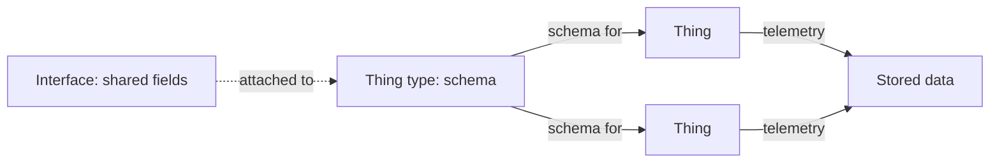

IoT Breeze trennt, was eine Art von Gerät ist, von den einzelnen Geräten. Ein **Thing-Typ** legt fest, welche Werte ein Gerät sendet und welche festen Angaben es hat. Ein **Thing** ist ein echtes Gerät, das einem Thing-Typ folgt. Ein **Interface** ist eine Menge von Feldern, die mehrere Thing-Typen teilen können, sodass ein Dashboard für alle funktioniert.

## Die Bestandteile {#the-parts}

| Bestandteil | Was es ist | Wo |
| --- | --- | --- |
| **Thing-Typ** | Das Modell eines Geräts: seine Messwerte und Eigenschaften, plus Einstellungen wie Konnektor, Schema-Evolution und Bereinigungs-Pipeline. | **Geräte › Thing Typen** |
| **Thing** | Ein echtes Gerät oder eine Anlage. Es hat einen Namen, eine ID, die das Gerät verwendet, einen Thing-Typ, eine Organisation und Gruppen. | **Geräte › Things** |
| **Aggregat-Thing** | Ein Thing ohne Gerät, von einem Thing-Typ der Art **Aggregat-Thing**. Es hält Mitglieds-Things in Slots und kombiniert ihre Messwerte in berechneten Messwerten. Siehe [Things zu einem Aggregat-Thing zusammenfassen](./aggregate-things.mdx). | **Geräte › Things**, Tab **Mitglieder** |
| **Interface** | Eine benannte, versionierte Menge von Feldern. Ein Thing-Typ, der es anhängt, erhält diese Felder. | **Geräte › Interfaces** |
| **Messwert** | Ein Wert, den das Gerät über die Zeit sendet, etwa `temperature`. Ein **berechneter Messwert** wird beim Lesen mit einer Formel berechnet; siehe [Einen berechneten Messwert hinzufügen](./calculated-measures.mdx). | Schema eines Thing-Typs oder Interfaces |
| **Eigenschaft** | Eine feste Angabe zum Gerät, etwa eine Seriennummer oder ein Nennvolumenstrom. | Schema eines Thing-Typs oder Interfaces |

Messwerte und Eigenschaften heißen zusammen Felder. Die vollständige Liste der Optionen steht unter [Messwert- und Eigenschaftstypen](./measure-types.mdx).

## Wie sie zusammenspielen {#how-they-work-together}

Ein Thing übernimmt sein Schema von seinem Thing-Typ. Sie bearbeiten einen Messwert nie an einem Thing, sondern nur am Typ, und jedes Thing dieses Typs ändert sich mit. Der Typ eines Things steht beim Anlegen fest: Das Feld **Thing Typ** ist beim Bearbeiten eines Things gesperrt.

Das Schema eines Thing-Typs hat zwei Quellen. **Eigene** Felder legen Sie am Thing-Typ fest. **Geerbte** Felder kommen von angehängten Interfaces und sind dort schreibgeschützt; Sie ändern sie im Interface.

Ein Thing-Typ, der ein Interface anhängt, fixiert eine Version davon. Neue Versionen des Interfaces erreichen den Thing-Typ erst, wenn Sie die Aktualisierungsschaltfläche wählen, zum Beispiel **Auf v2 aktualisieren**. Siehe [Entwürfe, Veröffentlichen und Versionen](./drafts-and-versions.mdx).

Ein Smart-Dashboard baut auf einem Interface auf statt auf einem Gerät. Es zeigt jedes Thing, dessen Typ das Interface implementiert, auch Geräte, die Sie später hinzufügen.

## Die Wahl {#choosing-between-them}

| Sie möchten … | Nutzen Sie |
| --- | --- |
| Daten einer Art von Gerät auf einem Dashboard | Einen Thing-Typ mit Messwerten. Kein Interface nötig. |
| Geräte verschiedener Hersteller auf einem Dashboard | Ein Interface, an jeden Thing-Typ angehängt. Ordnen Sie Felder mit anderen Namen zu. |
| Einen Wert, der sich über die Zeit ändert | Einen Messwert. |
| Eine feste Angabe, etwa eine Seriennummer | Eine Eigenschaft. |
| Eine feste Angabe, nach der Telemetrie gefiltert oder gruppiert wird | Eine Eigenschaft mit **Zeitreihenrelevant** an. |
| Felder teilen, die Sie schon an einem Thing-Typ gebaut haben | **In Schnittstelle verschieben** am Thing-Typ. |

## Grenzen {#limits}

- Der **Name** eines Thing-Typs und die **Alternative Thing -ID** eines Things lassen sich nach dem Anlegen nicht ändern.
- Ein Thing-Typ, der noch Things hat, lässt sich nicht löschen. Löschen Sie zuerst die Things.
- Ein Interface, das Thing-Typen noch implementieren, lässt sich nicht löschen. Lösen Sie es zuerst überall.
- Ein vorinstalliertes Interface ist schreibgeschützt. Sie können es anhängen, Versionen vergleichen und auf eine neuere aktualisieren.

## Siehe auch {#related}

- [Einen Thing-Typ anlegen](./create-thing-type.mdx) · [Ein Thing registrieren](./register-thing.mdx) · [Ein Interface für mehrere Thing-Typen wiederverwenden](./reuse-interface.mdx)
- [Mitgelieferte Interfaces](./shipped-interfaces.mdx)
