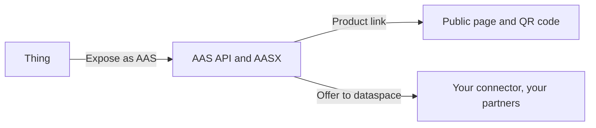

Wie gebe ich Kunden und Partnern Daten zu meinen Produkten, ohne ihnen Zugang zu IoT Breeze zu geben? Wählen Sie die Things aus, die Sie teilen möchten, veröffentlichen Sie sie als Verwaltungsschalen (Asset Administration Shell, AAS) und geben Sie sie auf einem von drei Wegen weiter. Alle drei sind aus, bis ein Tenant-Admin sie einschaltet, und geteilt wird nur, was Sie an jedem Thing einzeln auswählen.

## Umsetzen {#do}
- [Things als Verwaltungsschalen veröffentlichen](./asset-administration-shell.mdx): Typenschild, technische Daten, Dokumente, CO2-Fußabdruck und Zeitreihen über die schreibgeschützte AAS-API bereitstellen und AASX-Pakete exportieren.
- [Produktlinks und QR-Codes erstellen](./product-links.mdx): eine öffentliche Seite je Thing oder Thing-Typ mit den Feldern und Dokumenten Ihrer Wahl, und Etiketten zum Drucken.
- [Things im eigenen Dataspace-Connector anbieten](./dataspace-offers.mdx): Verwaltungsschalen als Angebote in Ihrem eigenen EDC-Connector veröffentlichen und aktuell halten.
