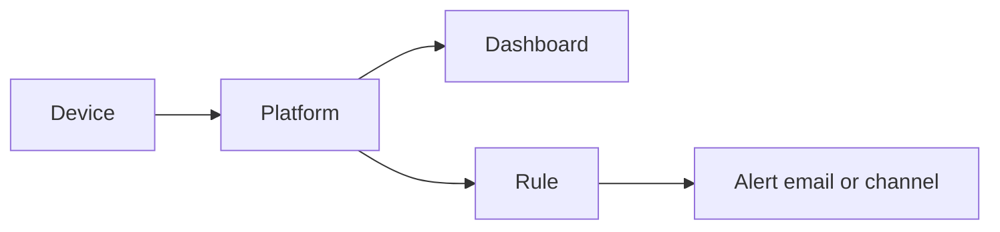

Gehen Sie von dem aus, was Sie sehen, nicht von dem, was Sie gebaut haben. Jede Anleitung listet die Prüfungen in der Reihenfolge, in der sie am häufigsten die Ursache finden, und nennt, was Sie an den Support schicken, wenn keine hilft.

## Verstehen {#understand}
- [Wie Geräte sich verbinden](../connect/how-devices-connect.mdx): was mit einer Nachricht passiert, bevor sie ein Diagramm erreicht.
- [Events, Vorfälle und Benachrichtigungen](../watch/events-incidents-notifications.mdx): warum ein Event nicht immer eine Nachricht bedeutet.

## Anwenden {#do}
- [Ein Gerät zeigt kein Signal](./no-signal.mdx): das Thing meldet **Noch kein Signal**, oder sein letztes Signal ist alt.
- [Ein Dashboard ist leer](./empty-dashboard.mdx): Widgets zeigen keine Werte, oder das erwartete Thing fehlt.
- [Eine Regel löst nicht aus](./rule-not-firing.mdx): die Bedingung müsste erfüllt sein, aber nichts passiert.
- [Eine Alarm-E-Mail kommt nie an](./email-not-arriving.mdx): das Event ist da, die E-Mail nicht.

## Nachschlagen {#look-up}
- [Glossar](./glossary.mdx): alle Begriffe in IoT Breeze, mit Link auf die Seite, die sie erklärt.
- [Ingest-Endpoints und Statuscodes](../connect/ingest-endpoints.mdx) · [Fehler und Limits](../api/errors-and-limits.mdx)
