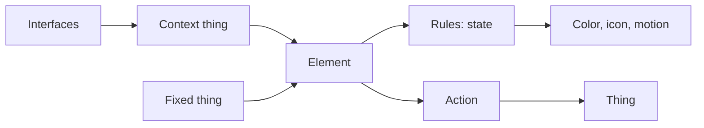

Ein Canvas ist eine Zeichnung mit Live-Daten. Ein Dashboard ordnet Widgets in einem Raster an, ein Canvas setzt Werte genau dorthin, wo die Anlage steht: auf einen Grundriss, ein Maschinenfoto oder eine Prozesszeichnung. Wer es öffnet, sieht die Anlage, wie sie jetzt ist oder zu einem früheren Zeitpunkt war.

## Die Bausteine {#the-parts}

| Baustein | Was es ist |
| --- | --- |
| **Element** | Ein Eintrag auf dem Canvas: ein Wert, ein Gauge, ein Diagramm, eine Form, ein Symbol, eine Schaltfläche. Die Bibliothek ordnet sie in Abschnitte: **Daten**, **Bedienelemente**, **Zeichnen & Grundformen**, **Einbettungen** und **R&I-Symbole**. |
| **Kontext-Thing** | Das Thing, das ein Betrachter in der Kopfzeile wählt. Elemente, die **Aus dem Kontext** lesen, zeigen dieses Thing. Ein Canvas bedient so jedes Thing, das die Interfaces des Canvas bietet. |
| **Festes Thing** | Ein Element, das immer dasselbe Gerät liest, egal was der Betrachter wählt. |
| **Bindung** | Die Verbindung eines Elements zu einem Wert: einem Thing, einer Telemetrie oder einer Eigenschaft. Optionale **Schwellenwerte** färben es ein. |
| **Zustand** | Eine benannte Bedingung wie `high alarm`, die **Regeln** zuweisen, wenn ein Wert eine Grenze überschreitet. Ein Zustand hat einen Schweregrad und ändert Farbe, Icon und Bewegung. |
| **Aktion** | Was beim Klick geschieht: eine Aktion eines Things ausführen, einen Link oder ein anderes Canvas öffnen, das Kontext-Thing wechseln oder eine Variable setzen. |
| **Art** | **Überwachung** (Werte und Diagramme) oder **R&I** (eine Prozesszeichnung). Sie sortiert das Canvas nur in die Filter der Canvas-Liste. |
| **Von Nimbit verwaltet** | Ein Canvas aus einer Vorlage, das Vorlagen-Updates erhält. Sie können eine Vorlage auch als Kopie hinzufügen, um sie frei zu ändern. |

## Wie sie zusammenwirken {#how-they-work-together}

**Kontext oder fest.** In den **Canvas-Einstellungen** wählen Sie die Interfaces des Canvas. Mit Interfaces wählen Betrachter ein Kontext-Thing, und Elemente lesen **Aus dem Kontext**. Ohne sie ist jedes Element an ein festes Thing gebunden. Sie können beides auf einem Canvas mischen.

**Live oder Verlauf.** Ein Canvas zeigt Live-Werte. Ein Zeitraum in der Kopfzeile zeigt, wie die Werte damals aussahen. Ein Live-Zeitraum bringt die aktuellen Werte zurück.

**Alarme.** Ist ein Wert im Alarm oder veraltet, listet ihn ein Chip in der Kopfzeile. Wählen Sie ihn, um zum nächsten zu springen. Ein Wert ohne Update innerhalb der Veraltet-Grenze (je Canvas festgelegt, je Element überschreibbar) wird als veraltet angezeigt.

**Bedienen.** Schaltflächen, Schalter, Sollwerte und Ventilaktionen senden Befehle an echte Anlagen. Ein Canvas tut das nur, wenn **Bedienung erlauben** in den **Canvas-Einstellungen** aktiv ist, und die eigenen Berechtigungen jeder Aktion entscheiden weiterhin, wer sie ausführen darf. Befehle fragen meist zuerst nach einer Bestätigung.

**Gespeichert oder Entwurf.** Sie bearbeiten direkt. Alle anderen sehen weiter die gespeicherte Version, bis Sie **Speichern** wählen.

## Canvas oder Dashboard {#canvas-or-dashboard}

| Sie möchten … | Nehmen Sie … |
| --- | --- |
| Werte auf einem Bild der Anlage | Ein Canvas |
| Ein Raster aus Diagrammen, Tabellen und Kennzahlen, das Benutzer umordnen | Ein [Dashboard](../dashboards.mdx) |
| Eine Prozesszeichnung mit Pumpen, Ventilen und Tanks | Ein Canvas der Art **R&I** |
| Beides: eine Zeichnung neben Diagrammen | Ein Canvas, auf einem Dashboard mit dem [Canvas-Widget](./embed-a-canvas.mdx) gezeigt |

## Grenzen {#limits}

- Der Editor öffnet sich auf einem größeren Bildschirm.
- Die Bedienung pausiert, solange ein vergangener Zeitraum angezeigt wird. In einem Seitenpanel oder einer Einbettung öffnen Sie die ganze Seite, um zu bedienen.
- Ein Canvas, das zu groß zum Speichern ist, braucht weniger Elemente oder muss auf mehrere Canvases aufgeteilt werden.
- Ein Canvas kann ein anderes Canvas einbetten, bis zu drei Ebenen tief, und nie sich selbst.
- Bilder dürfen bis zu 20 MB groß sein: PNG, JPG, SVG oder WebP.

## Verwandte Seiten {#related}
- [Einen Grundriss zeichnen](./draw-a-floor-plan.mdx) · [Referenz des Canvas-Editors](./editor-reference.mdx)
