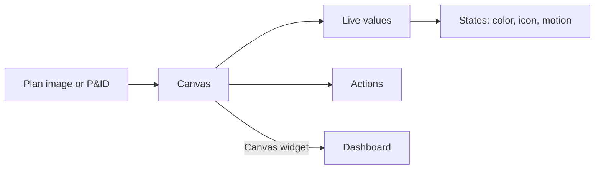

import TourLink from "@site/src/components/TourLink";

Ein Canvas ist eine Zeichnung Ihrer Anlage oder Maschine mit Live-Werten. Sie platzieren Werte, Gauges, Diagramme, Formen und Prozesssymbole, binden sie an Things, und Betrachter sehen sie sich aktualisieren, sobald Geräte melden. Canvases öffnen Sie unter **Überwachung › Canvas**.

<TourLink id="canvas" />

## Verstehen {#understand}
- [Wie ein Canvas funktioniert](./how-canvas-works.mdx): was ein Canvas ist, welche Arten es gibt, wie es sich von einem Dashboard unterscheidet und wie Werte und Aktionen gebunden werden.

## Umsetzen {#do}
- [Einen Grundriss zeichnen](./draw-a-floor-plan.mdx): von einem Planbild ausgehen und Live-Elemente darauf platzieren.
- [Elemente an Live-Werte binden](./bind-live-values.mdx): Thing, Telemetrie und Schwellenwerte wählen.
- [Zustand durch Farbe, Icon und Bewegung zeigen](./states-and-colors.mdx): Störungen auf einen Blick erkennbar machen.
- [Aktionen aus einem Canvas ausführen](./actions.mdx): Schaltflächen, die einen Befehl senden, ein Canvas öffnen oder das Thing wechseln.
- [Ein Canvas auf ein Dashboard legen](./embed-a-canvas.mdx): ein Canvas neben anderen Widgets zeigen.

## Nachschlagen {#look-up}
- [Referenz des Canvas-Editors](./editor-reference.mdx): jedes Werkzeug, Element, jede Bindungsoption und Aktionsart.
