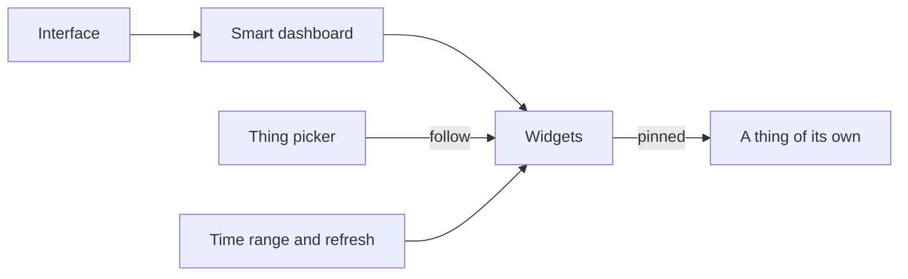

Ein Dashboard ist eine Seite voller Widgets. Jedes Widget beantwortet eine Frage: Wie warm ist es jetzt, wie hat sich ein Wert heute entwickelt, welche Things sind offline. Drei Dinge bestimmen, was ein Widget zeigt: das Thing, das es liest, der Zeitraum, den es abdeckt, und wie es aktualisiert wird. Eine Leiste oben im Dashboard steuert alle drei für alle Widgets gleichzeitig.

## Die Bausteine {#the-parts}

| Baustein | Was es ist |
| --- | --- |
| **Smart-Dashboard** | Das Dashboard, das Sie heute anlegen. Es ordnet Things über die **Interfaces** zu, die ihre Thing-Typen umsetzen. Ein Dashboard bedient so jedes passende Thing, jetzt und später. |
| **Interface** | Ein benannter Satz von Telemetrien, etwa Vor- und Rücklauftemperatur, den ein Thing-Typ zu senden verspricht. |
| **Widget** | Eine Kachel. Sie liest ein Thing oder den ganzen Tenant. Siehe [Widget-Galerie](./widgets.mdx). |
| **Thing-Auswahl** | Oben in einem Smart-Dashboard. Sie wählt das Thing, das folgende Widgets zeigen. |
| **Zeitleiste** | Der Zeitraum, der Aktualisierungsmodus und **Zeitreise**. |
| **Datenquelle** | **Gerät** (Live-Werte), **Testdaten** oder **Datei**, zum Entwerfen, bevor ein Gerät Daten sendet. |
| **Bearbeitungsmodus** | Änderungen bleiben ein Entwurf, bis Sie speichern. Niemand sonst sieht sie vorher. |

Ein Dashboard für ein Thing ist ein Smart-Dashboard, das diesem Thing zugewiesen ist. Ältere Dashboard-Arten (Thing-Typ-Dashboards, Collections) gibt es weiterhin. Sie öffnen sie dort, wo sie hingehören.

## Wie sie zusammenwirken {#how-they-work-together}

### Folgen oder anheften {#follow-or-pin}

Jedes Widget liest seine Daten auf eine von zwei Arten, die Sie beim Hinzufügen wählen.

| Modus | Das Widget zeigt | Einsatz |
| --- | --- | --- |
| **Dem Dashboard folgen** | Das Thing, das oben gewählt ist. | Dieselbe Ansicht für jede Lüftungsanlage, Pumpe oder jeden Raum. |
| **Eigene Things** (angeheftet) | Das Thing, das Sie benennen, egal was gewählt ist. | Ein bestimmtes Thing, etwa die Außentemperatur oder den Hauptzähler. |

Ein angeheftetes Widget zeigt in seiner Kopfzeile eine Stecknadel mit dem Namen des Things. Ein Dashboard kann beides enthalten.

Ein Thing, das nur einen Teil der Interfaces des Dashboards umsetzt, lässt sich trotzdem wählen. Es zeigt seine Abdeckung, etwa **2 von 3 Schnittstellen**, und Widgets zu den fehlenden Interfaces bleiben leer.

### Wo ein Dashboard erscheint {#where-a-dashboard-shows-up}

Ein Dashboard wird an einem Thing angeboten, weil es **zugewiesen** ist: dem Thing, seinem Thing-Typ oder über ein verlangtes Interface. Verlangt ein Dashboard ein Interface, erhält jeder Thing-Typ mit diesem Interface das Dashboard automatisch. Ein Dashboard, das kein Thing braucht, kann auf [Home](./home.mdx).

### Zeit {#time}

Diagramme und andere zeitbezogene Widgets zeigen den Zeitraum des Dashboards. Die Dashboard-Zeit ist immer aktiv.

- **Zeitraum.** Wählen Sie eine Vorgabe von **Letzte 5 Minuten** bis **Letzte 5 Jahre**, **Heute**, **Gestern** und andere Kalenderzeiträume oder legen Sie Anfang und Ende selbst fest. Der Zeitraum ist Teil des Links, ein geteilter Link zeigt also, was Sie sehen.
- **Standardzeitraum.** Ändern Sie den Zeitraum beim Bearbeiten, fragt das Speichern **Diesen Zeitraum ebenfalls speichern?** **Mit Zeitraum speichern** macht ihn zum Standard des Dashboards. **Nur Dashboard** behält den alten Standard.
- **Aktualisierung.** **Live-Charts** zeigt Werte, sobald sie gemeldet werden. **Intervall-Updates** lädt im gewählten **Aktualisierungsintervall** neu. **Manuell** lädt neu, wenn Sie die Schaltfläche zum Aktualisieren wählen.
- **Widgets mit eigenem Zeitraum.** Ein Widget kann einen eigenen Zeitraum behalten. Tun das einige, steht in der Leiste *N Widgets behalten ihren eigenen*. Damit eines wieder dem Dashboard folgt, entfernen Sie den Zeitraum in den Einstellungen des Widgets.
- **Zeitreise.** Zeigt das ganze Dashboard, wie es zu einem früheren Zeitpunkt war. Wählen Sie **Live**, um zur Gegenwart zurückzukehren.

### Testdaten und Dateien {#mock-data-and-files}

Bevor ein Gerät Daten sendet, können Sie mit **Testdaten** (Muster **Zufällig**, **Gleichmäßig**, **Welle**, **Rampe**, **Stufen** und **Ausreißer**) oder mit einer CSV-, Parquet- oder JSON-**Datei** entwerfen. Beides wird in Ihrem Browser gelesen, und nichts wird in ein Gerät oder seinen Verlauf geschrieben. An ein Thing angeheftete Widgets zeigen weiterhin echte Daten.

## Zwischen Dashboard-Arten wählen {#choosing-between-dashboard-kinds}

| Sie möchten … | Nehmen Sie … |
| --- | --- |
| Eine Ansicht für ein bestimmtes Thing | [Ein Dashboard für ein Thing](./thing-dashboard.mdx) |
| Dieselbe Ansicht für jedes Thing einer Art, jetzt und später | [Ein Smart-Dashboard auf Interfaces](./smart-dashboard.mdx) |
| Eine Seite für den ganzen Tenant: Kennzahlen, Offline-Things, Verknüpfungen | Ein Smart-Dashboard ohne Interfaces, [auf Home](./home.mdx) |
| Eine Zeichnung mit Werten darauf | Ein [Canvas](./canvas/index.mdx), wahlweise als Widget eingebettet |

## Dashboard-Hierarchie {#dashboard-hierarchy}

Optional kann ein Tenant-Admin unter **Arbeitsbereich › Arbeitsbereich-Einstellungen › Funktionen** die **Dashboard-Hierarchie** einschalten. Sie ist ein Baum aus Knoten, etwa Standorten, Gebäuden oder Bereichen, um Dashboards abzulegen und zu durchsuchen. Der Baum hilft nur beim Finden. Ein Dashboard erscheint an einem Thing über seine Zuweisung, nicht über seinen Knoten.

## Grenzen {#limits}

- Dashboards lesen, anlegen und bearbeiten sind getrennte Berechtigungen. Fehlt eine Schaltfläche, fehlt Ihrer Rolle meist eine davon.
- Testdaten und Dateien werden nicht gespeichert. Wählen Sie nach einem Neuladen die lokale Datei erneut oder setzen Sie den Haken bei **Eine Kopie in Dateien speichern**.
- Aktualisieren Sie innerhalb weniger Sekunden erneut, bittet Sie die App zu warten.

## Verwandte Seiten {#related}

- [Widget-Galerie](./widgets.mdx) · [Ein Dashboard teilen oder einbetten](./share.mdx)
