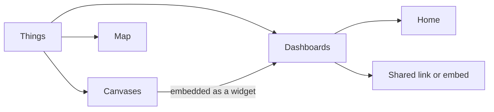

Wie sehe ich meine Daten? Ein Dashboard ist eine Seite voller Widgets, die jeweils eine Frage zu Ihren Things beantworten. Ein Canvas ist eine Zeichnung Ihrer Anlage mit Live-Werten. Die Karte zeigt, wo Things sind.

## Verstehen {#understand}
- [Dashboards, Smart-Dashboards und Zeit](./dashboards.mdx): wie ein Dashboard sein Thing, seine Widgets und seinen Zeitraum wählt.

## Umsetzen {#do}
- [Ein Dashboard für ein Thing bauen](./thing-dashboard.mdx): ein Dashboard anlegen, Widgets hinzufügen, anordnen und speichern.
- [Ein Dashboard für alle Things einer Art bauen](./smart-dashboard.mdx): Widgets folgen lassen oder anheften, das Dashboard zuweisen, mit Testdaten ausprobieren.
- [Einem Diagramm eine berechnete Reihe hinzufügen](./calculated-series.mdx): eine Formel über Messwerte des gewählten Things oder fester Things zeichnen.
- [Ein Dashboard auf Home zeigen](./home.mdx): beim Start der App allen oder nur sich selbst ein Dashboard zeigen.
- [Ein Dashboard teilen oder einbetten](./share.mdx): festlegen, wer es sieht, einen Link senden oder es in eine andere Seite einbetten.
- [Einen Grundriss mit Live-Werten zeichnen](./canvas/index.mdx): Werte, Gauges und Symbole auf ein Bild Ihrer Anlage setzen.
- [Things auf einer Karte zeigen](./map.mdx): Things finden, filtern und nachvollziehen, wohin sich mobile Things bewegt haben.

## Nachschlagen {#look-up}
- [Widget-Galerie](./widgets.mdx): jedes Widget, was es zeigt und welche Einstellungen es hat.
