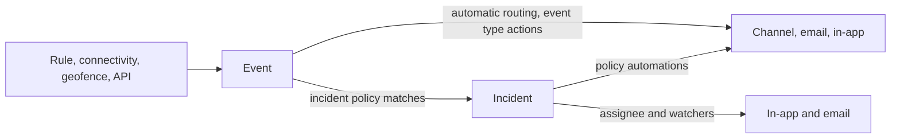

Geht in Ihrer Anlage etwas schief, tut IoT Breeze drei getrennte Dinge: Es zeichnet auf, was passiert ist, entscheidet, ob sich eine Person darum kümmern muss, und informiert Personen. Weil diese Schritte getrennt bleiben, werden aus zwanzig gleichen Alarmen keine zwanzig Anrufe.

## Die Teile {#the-parts}

| Teil | Was es ist | Wie viele |
| --- | --- | --- |
| **Event** | Ein Eintrag, dass etwas passiert ist: eine Regel traf zu, ein Thing ging offline, ein Thing verließ einen Geofence, jemand änderte einen Datensatz. Ein Fakt mit Zeit, Schweregrad und meist einem Thing. Sie können ihn nicht bearbeiten. | Viele. Die meisten brauchen niemanden. |
| **Vorfall** | Ein Problem, das eine Person braucht. Er sammelt die Events, die zusammengehören, und wechselt von **Offen** zu **Geschlossen**. | Wenige. Einer pro Problem. |
| **Vorfallsrichtlinie** | Die Regel, die entscheidet, welche Events einen Vorfall öffnen und wie Events zu einem gruppiert werden. | Eine Handvoll pro Tenant. |
| **Benachrichtigung** | Eine Nachricht zu einem Event oder Vorfall: in der App, in einem Kanal oder per E-Mail. | So viele, wie Sie routen. |

## Wie sie zusammenarbeiten {#how-they-work-together}

Jedes Event wird aufgezeichnet. Sie sehen es unter **Überwachung › Events** und im Tab **Events** des Things.

Passt eine Vorfallsrichtlinie zum Event, öffnet es einen neuen Vorfall oder schließt sich dem offenen an, zu dem es gehört. Ohne Richtlinie öffnen Events nie Vorfälle, doch eine Person kann einen von Hand melden. Jemand quittiert den Vorfall, bearbeitet ihn und löst ihn. Der Vorfall behält den Verlauf.

Events und Vorfälle erreichen Personen auf verschiedenen Wegen:

- **Events** erreichen einen Kanal über sein **Automatisches Routing** oder über eine Aktion am Event-Typ: **Benachrichtigung**, **Benachrichtigungskanal**, **E-Mail** oder **Webhook**. Beide laufen bei jedem passenden Event, ein flatternder Alarm sendet also viele Nachrichten.
- **Vorfälle** informieren bei jeder Änderung die zugewiesene Person und die Beobachter, in der App und per E-Mail. Über das, was jemand selbst getan hat, wird niemand informiert, und wer den Vorfall stummgeschaltet hat, wird übersprungen. Ein Vorfall erreicht einen Kanal nur über eine Automatisierung seiner Richtlinie, die einmal pro Zustandswechsel läuft.

Die eigenen Filter eines Kanals (**Mindestschweregrad** und **Ereignistypen**) gelten für jede Nachricht, die an ihn geht, egal wie sie dorthin kam.

## Was wann passt {#choosing-between-them}

| Sie möchten … | Verwenden Sie |
| --- | --- |
| Einen Eintrag, was passiert ist | Nichts einzurichten. Regeln, Konnektivität und Geofences erzeugen Events. |
| Dass jemand ein Problem bis zur Behebung verantwortet | Eine [Vorfallsrichtlinie](./incident-policy.mdx). |
| Jede Warnung und jeden Fehler im Chat Ihres Teams | Einen [Benachrichtigungskanal](./alert-channels.mdx) mit automatischem Routing. |
| Eine Chat-Nachricht pro Problem, auch wenn der Alarm flattert | Eine Automatisierung an der Vorfallsrichtlinie. |
| Eine E-Mail an eine bestimmte Person oder Liste | Eine **E-Mail**-Aktion am Event-Typ. |

## Limits {#limits}

- E-Mail ist kein Kanal. E-Mail geht über eine **E-Mail**-Aktion hinaus, und Vorfalls-E-Mails gehen an die zugewiesene Person und die Beobachter.
- Events, die einen Zustand beenden, etwa ein Thing, das wieder online ist, führen keine Aktionen des Event-Typs aus und werden nicht an Kanäle geroutet.
- Vorfallsbenachrichtigungen werden nie per **Automatischem Routing** geroutet. Verwenden Sie eine Richtlinien-Automatisierung.

## Verwandte Seiten {#related}

- [Einen Vorfall bearbeiten](./work-an-incident.mdx)
- [Event-Typen](./event-types.mdx)
- [Kanaltypen](./channel-types.mdx)
