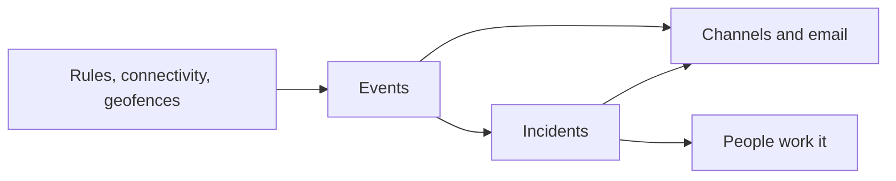

import TourLink from "@site/src/components/TourLink";

Dieser Bereich beantwortet zwei Fragen: Was passiert gerade, und was braucht mich? Things prüfen, nachlesen, was passiert ist, und Vorfälle bearbeiten Sie täglich. Vorfallsrichtlinien, Benachrichtigungskanäle und E-Mail-Vorlagen richten Sie einmal ein, damit Probleme die richtigen Personen erreichen.

<TourLink id="find-your-way-watch" />

Die Seiten unten öffnen Sie im Menü unter **Überwachung**. Die Einrichtungsseiten finden Sie unter **Alarmierung**. Sie sehen nur die Einträge, die Ihre Rolle erlaubt.

## Verstehen {#understand}

- [Events, Vorfälle und Benachrichtigungen](./events-incidents-notifications.mdx): was aufgezeichnet wird, was eine Person braucht und wer informiert wird.

## Erledigen {#do}

- [Den Zustand eines Things prüfen](./thing-health.mdx): Ist es verbunden, wann hat es zuletzt gemeldet, was ist mit ihm passiert.
- [Telemetrie über die Zeit untersuchen](./explore-telemetry.mdx): Messwerte beliebiger Things darstellen und das Diagramm speichern.
- [Einen Vorfall bearbeiten](./work-an-incident.mdx): quittieren, zuweisen, lösen.
- [Eine Vorfallsrichtlinie einrichten](./incident-policy.mdx): festlegen, welche Events Vorfälle öffnen und wer informiert wird.
- [Alarme an Teams, Slack oder einen Webhook senden](./alert-channels.mdx): Warnungen und Fehler in einen Chat-Kanal posten.
- [Einen Geofence zeichnen](./geofence.mdx): Events auslösen, wenn ein Thing einen Bereich betritt oder verlässt.

## Nachschlagen {#look-up}

- [Event-Typen](./event-types.mdx): Event-Quellen, Schweregrade, Anzeigetypen und Aktionen.
- [Vorfallszustände und -felder](./incident-fields.mdx): der Workflow, Status, Gründe und benutzerdefinierte Felder.
- [Kanaltypen](./channel-types.mdx): Felder, Routing-Filter und Zustellung jedes Kanals.
- [E-Mail-Vorlagen und Platzhalter](./mail-templates.mdx): Kontexte, Blöcke und Zuweisung.

Regeln, die aus Gerätedaten Events erzeugen, bauen Sie unter Automatisierung. Siehe [Regeln, Aktionen und Berichte](../automate/rules-actions-reports.mdx).
